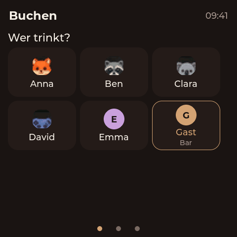
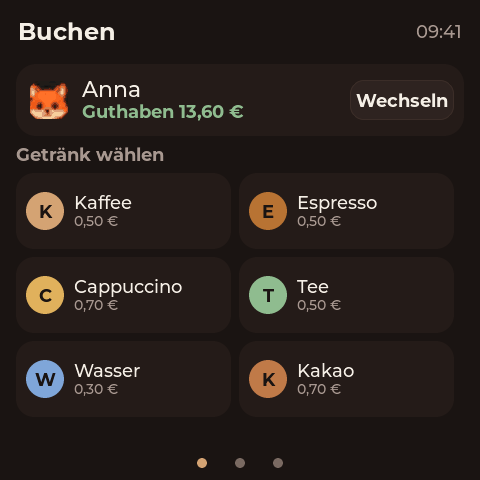
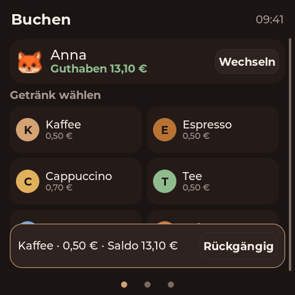
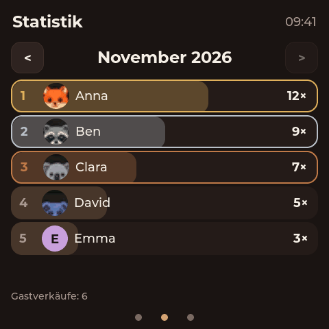
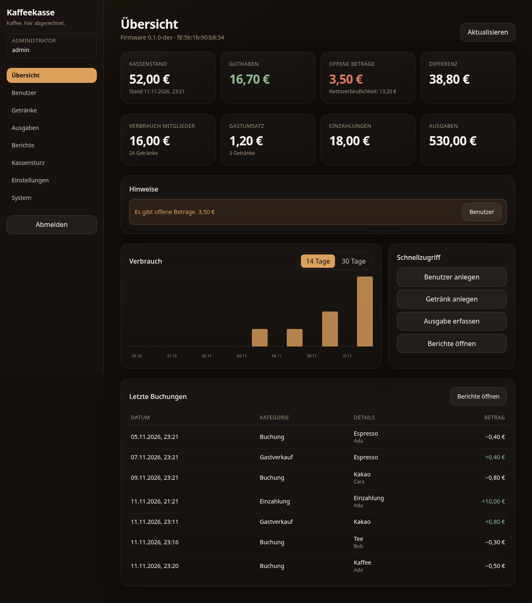
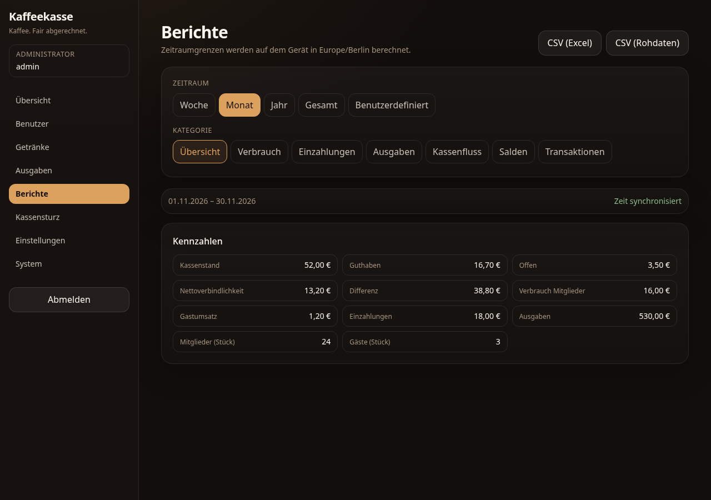
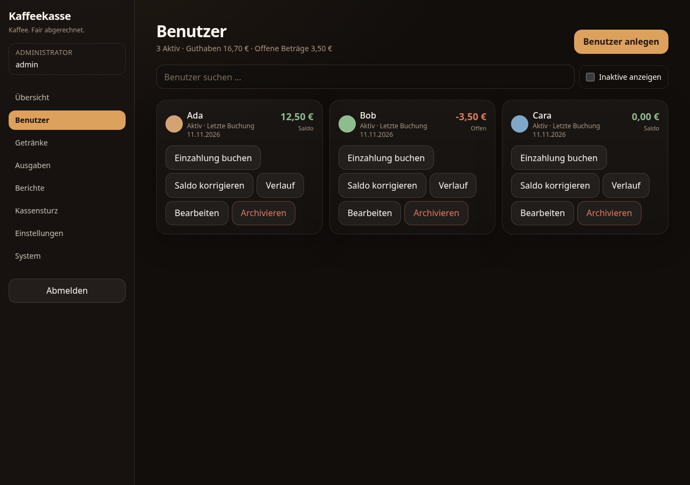
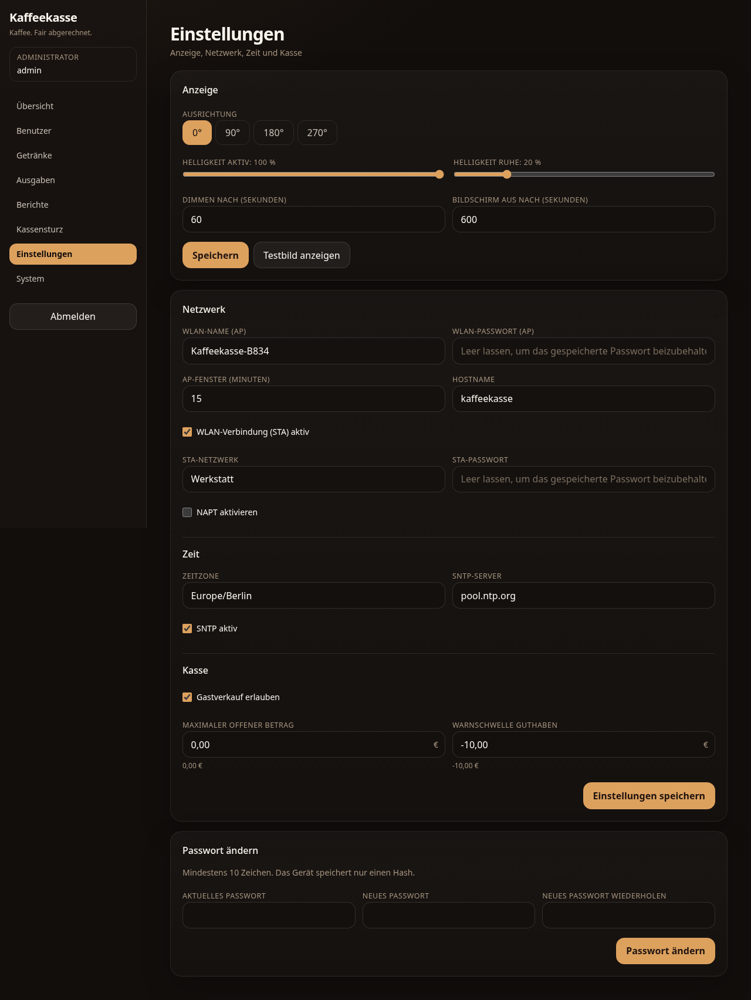

# Kaffeekasse

A self-contained coffee fund kiosk for the **Guition ESP32-4848S040** (ESP32-S3,
4.0" 480×480, ST7701S RGB panel, GT911 touch, 16 MB flash, 8 MB PSRAM).

- **Device:** trust-based, two-tap booking on LVGL 9. Select your name, tap a
  drink, done. Optional guest cash sales.
- **Admin:** on-device web backend over a demand-activated WLAN AP (or the LAN).
  Users, drinks, payments, expenses, reports, CSV exports, backup, OTA, display
  settings.
- **Self-contained:** no cloud, no external database, no runtime internet
  dependency. Optional STA Wi-Fi is only used for time sync and convenience.

## Status

v1 is implemented and running on the real board:

- 3-page German LVGL kiosk (booking, monthly leaderboard, system/AP/QR)
- on-device admin backend: users, top-ups, products, expenses, cash count,
  weekly/monthly/yearly reports, Excel-compatible CSV, backup/restore, OTA
- post-pay member balances, guest cash sales, voids and audit trail
- on-demand WLAN AP with captive DNS, first-boot setup password, QR codes
- serial console for diagnostics/recovery (`status`, `ap`, `time`, `backup`,
  `factory-reset`, `book`/`void` for HIL)
- ESP-IDF 5.5, 16 MB flash / 8 MB PSRAM, ~2.78 MB app image

Hardware checks still pending: touch corners at 0/90/180/270, frame rate during
swipes, and dim/off/wake timing. See `docs/tasks/` for the live status.

## Screenshots

Generated by the LVGL SDL simulator with seeded demo data (`make screenshots`).
The device UI is 480×480, German, espresso-themed.

| Buchen | Benutzer gewählt | Buchung + Rückgängig |
|---|---|---|
|  |  |  |

| Statistik | System / WLAN-QR |
|---|---|
|  |  |

### Admin backend

| Übersicht | Berichte |
|---|---|
|  |  |

| Benutzer | Einstellungen |
|---|---|
|  |  |

## Quick start

```sh
make bootstrap    # check toolchains, install web dependencies
make test         # host unit tests + web unit tests
make web          # build the admin SPA
make assets       # embed the SPA into the firmware
make build        # build firmware (requires ESP-IDF 5.x or Docker)
make flash        # flash /dev/ttyUSB0
make hil          # hardware smoke test (skips without a board)
make sim          # LVGL simulator on the host (interactive)
make screenshots  # regenerate the committed device screenshots
make test-ui      # LVGL click/hit-test smoke test
make check        # everything CI runs
```

The board is normally at `/dev/ttyUSB0` (CH340). Flashing from Docker:

```sh
make build-docker
make flash
```

## Documentation

| Document | Contents |
|---|---|
| `AGENTS.md` | Rules and workflow for human and AI contributors |
| `docs/architecture.md` | Runtime architecture and module boundaries |
| `docs/hardware.md` | Board, pin map, display/touch/power notes |
| `docs/data-model.md` | Domain types and ledger schema |
| `docs/accounting.md` | Post-pay, guest cash sales, cash reconciliation |
| `docs/api/openapi.yaml` | Admin REST contract |
| `docs/api/reports.md` | Expected report JSON payload shape and CSV conventions |
| `docs/ui.md` | Device and admin UI specification |
| `docs/security.md` | Threat model, auth, AP policy |
| `docs/operations.md` | Provisioning, backup, OTA, recovery |
| `docs/serial-cli.md` | Serial protocol, clock/backup/reset commands |
| `docs/testing.md` | Test strategy and hardware-in-the-loop |
| `docs/tasks/` | Task board for parallel agents |

## License

MIT. See `LICENSE`.
