# Screenshots

Device screenshots are generated by the LVGL simulator (`make screenshots`) and
committed so reviewers can see the device UI without hardware. Screenshot mode
fixes `TZ=Europe/Berlin`, the C locale, the wall clock and the LVGL tick, so
results are independent of the host timezone. CI regenerates the set and
compares decompressed pixels (`make screenshots-check`). The example users
include four avatar presets and one initials-only fallback; the web user list
also uses predefined avatars in its mock data.

Only the device captures live directly in this directory. `make
screenshots-check` byte-compares every top-level `*.png` against a freshly
generated simulator frame, so deterministic device output belongs here and
browser captures belong in `web/` (see below); anything else in the top level
fails the check with an unsupported-PNG error.

| Page 1 — booking | Page 1 — selected |
|---|---|
| 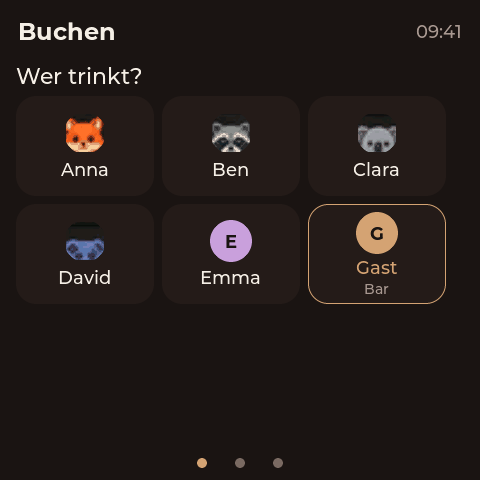 | 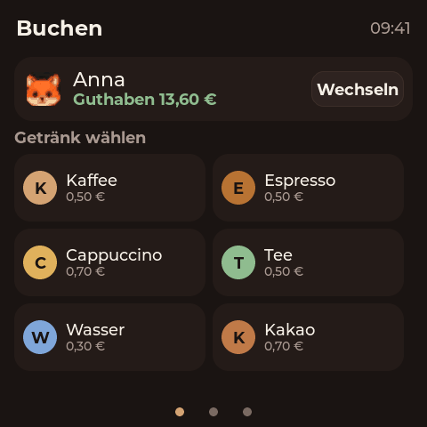 |

| Booking toast | Page 2 — leaderboard |
|---|---|
| 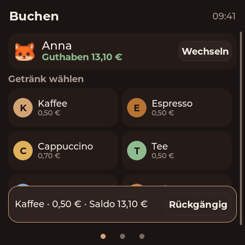 | 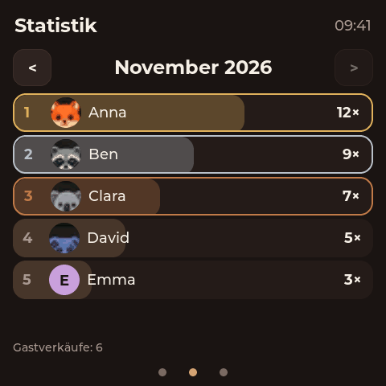 |

| Page 3 — system / AP QR |
|---|
|  |

## Admin web

Generated by `npm --prefix web run screenshots` against the mock API
(`web/mock/server.mjs`) into the `web/` subdirectory. Desktop 1280×900, mobile
390×844. These are browser captures, so they are documentation only and are not
part of the deterministic pixel comparison.

| Login | Übersicht |
|---|---|
| 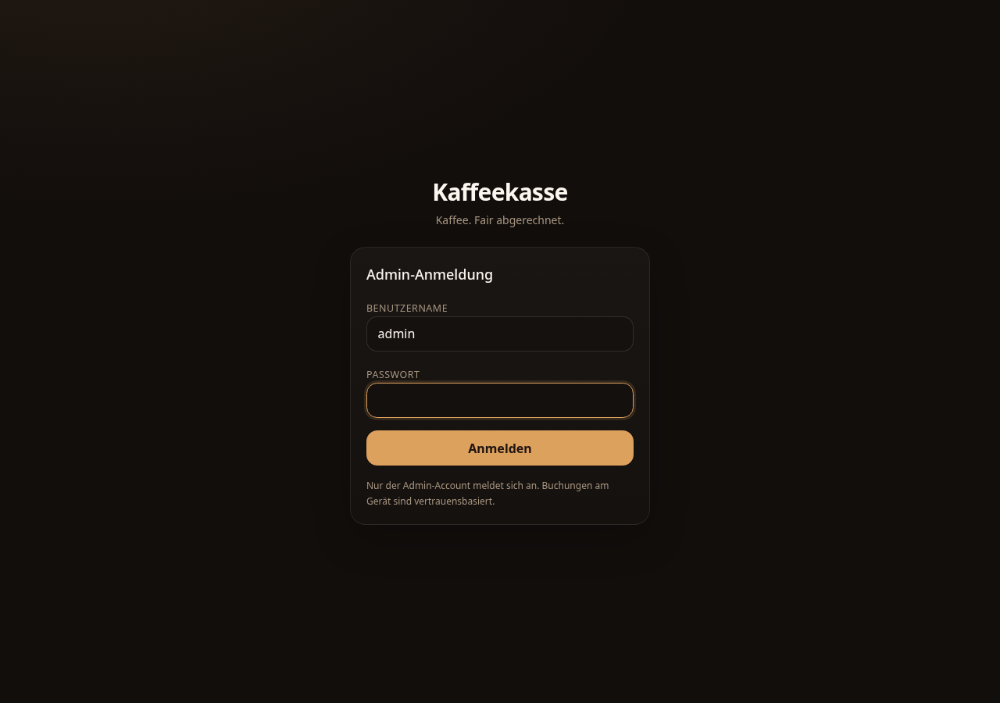 | 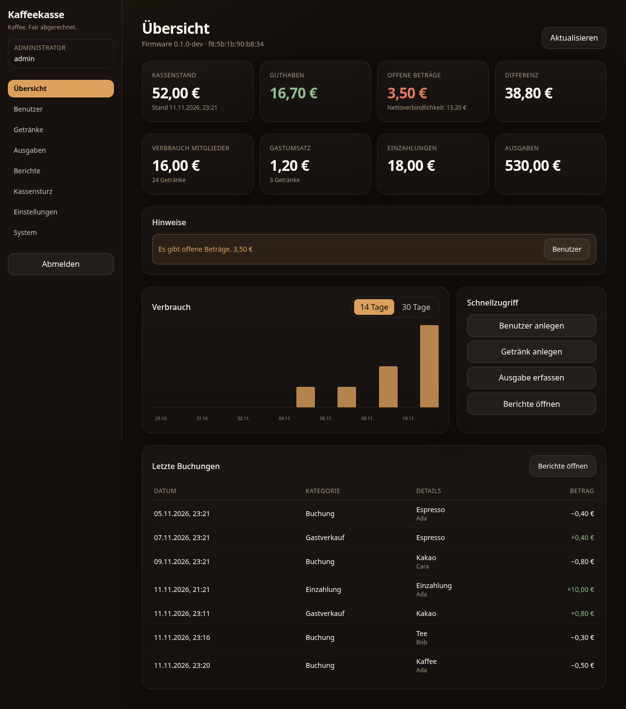 |

| Benutzer | Neuanlage (Zufalls-Avatar) |
|---|---|
| Benutzer | Getränke |
|---|---|
| 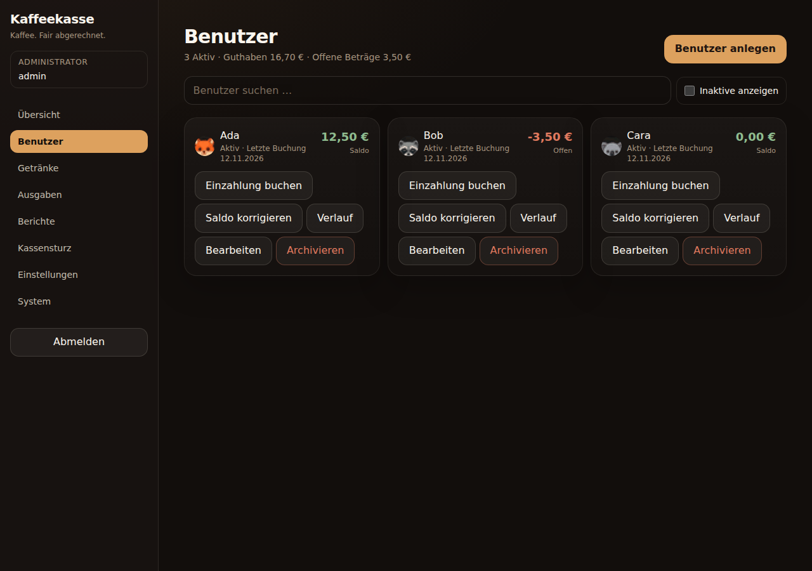 | 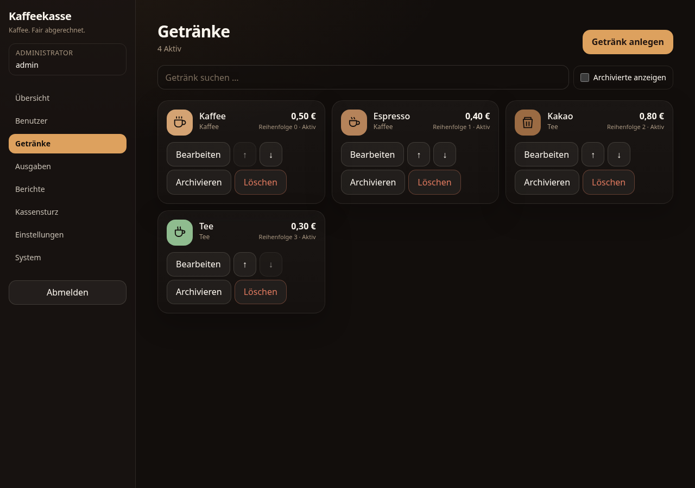 |

| Avatar-Auswahl beim Anlegen | Zufälliger Avatar in der Benutzerliste |
|---|---|
| 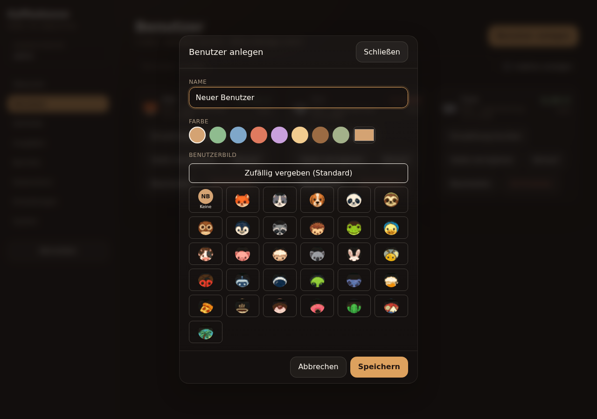 | 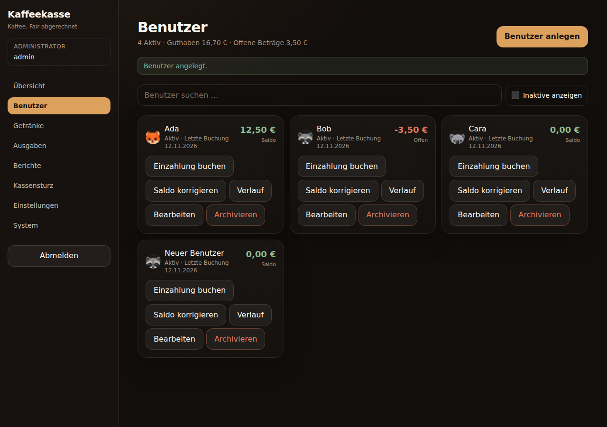 |

| Ausgaben | Kassensturz |
|---|---|
| 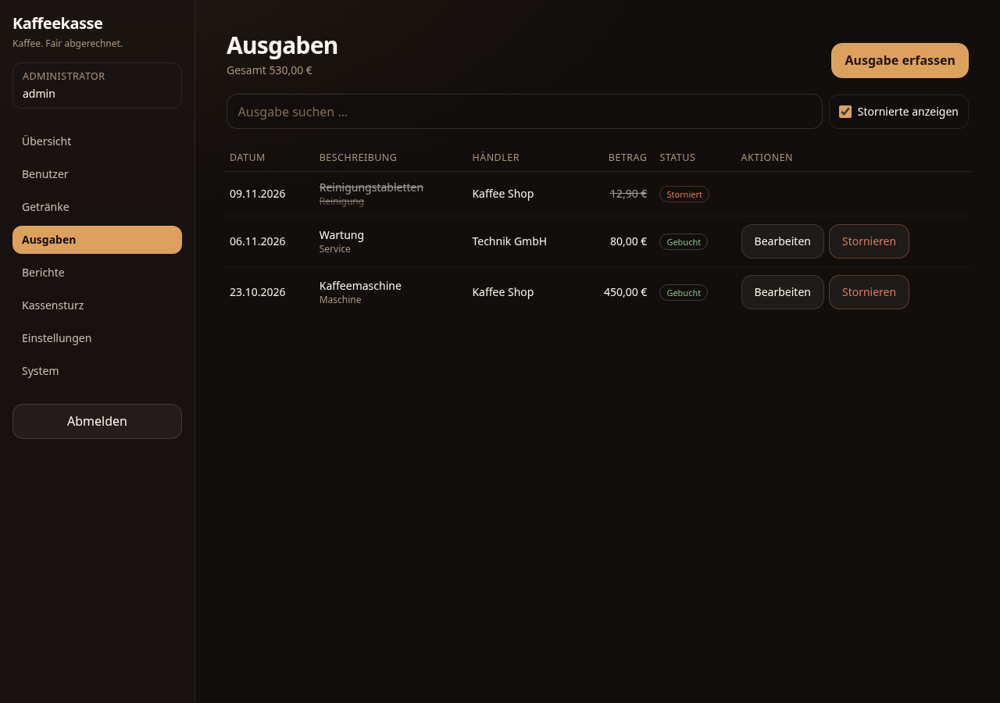 | 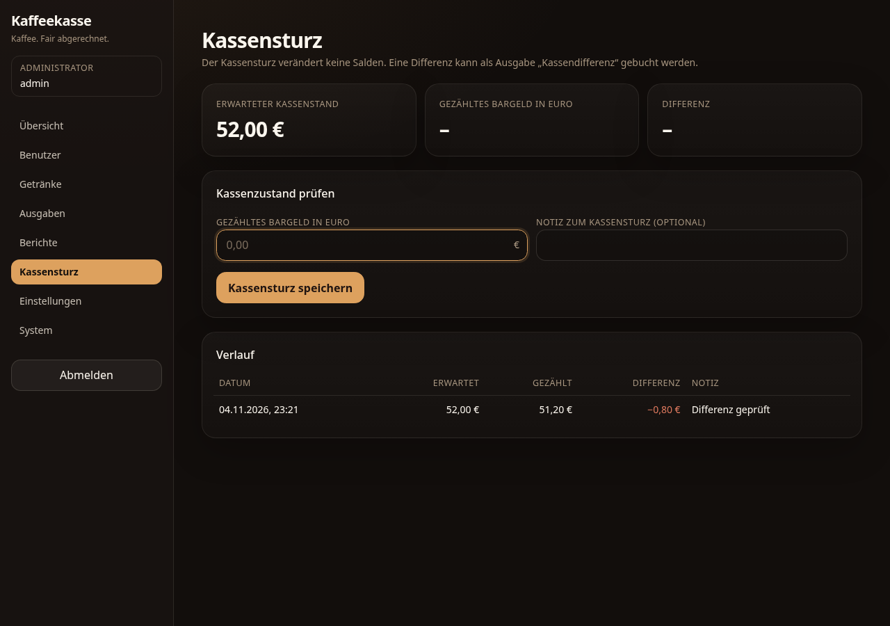 |

| Berichte | Einstellungen |
|---|---|
| 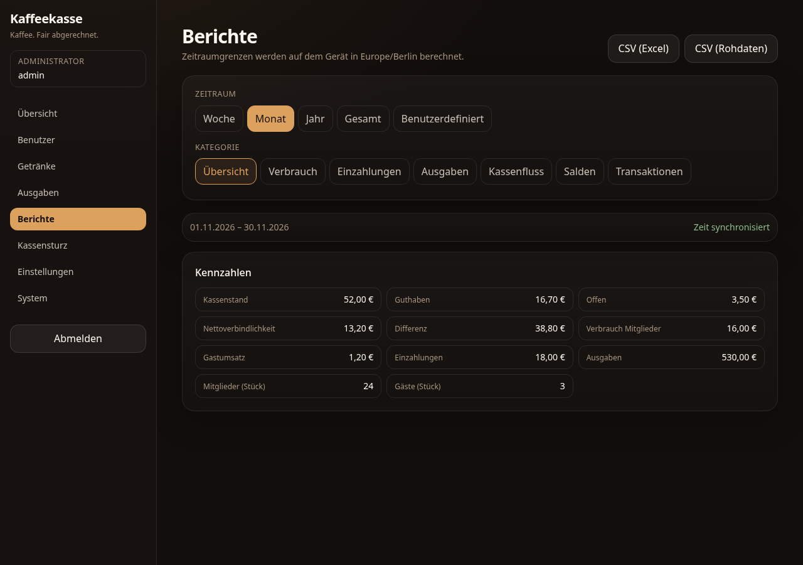 | 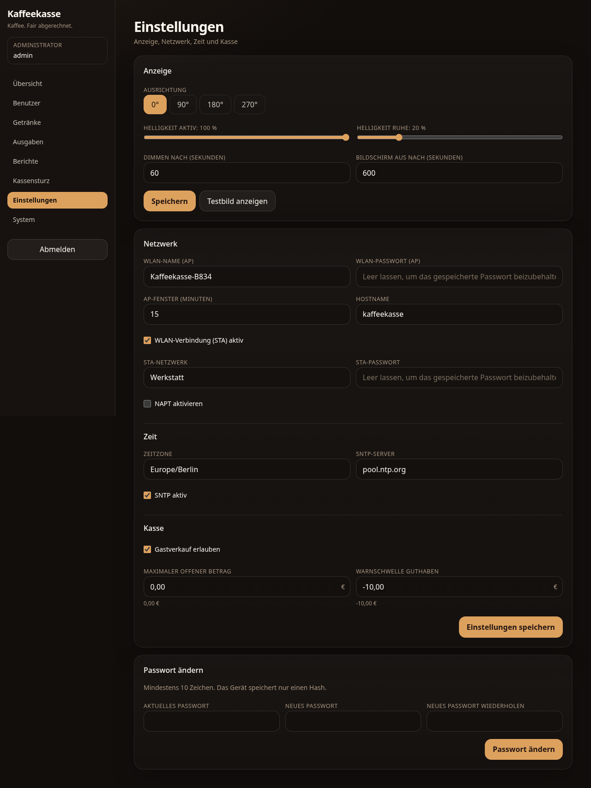 |

| System / AP QR |
|---|
| 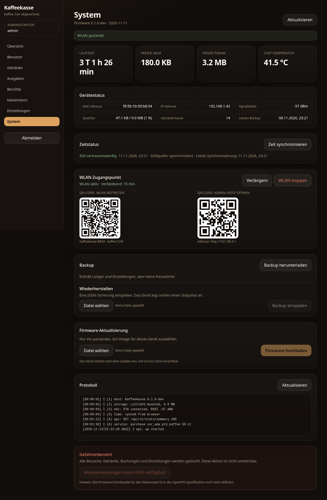 |

| Mobile Übersicht | Mobile Benutzer |
|---|---|
| 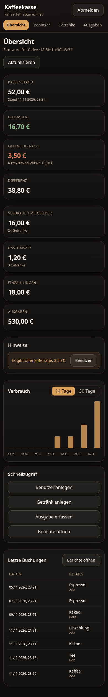 | 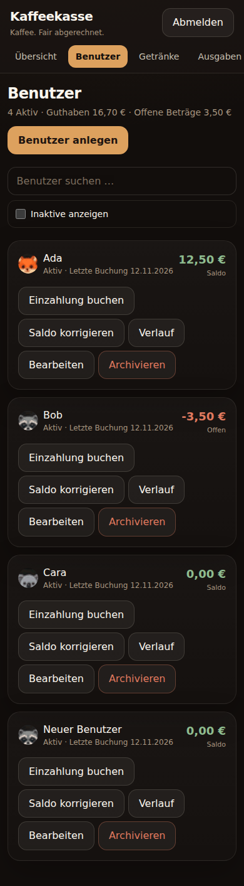 |
